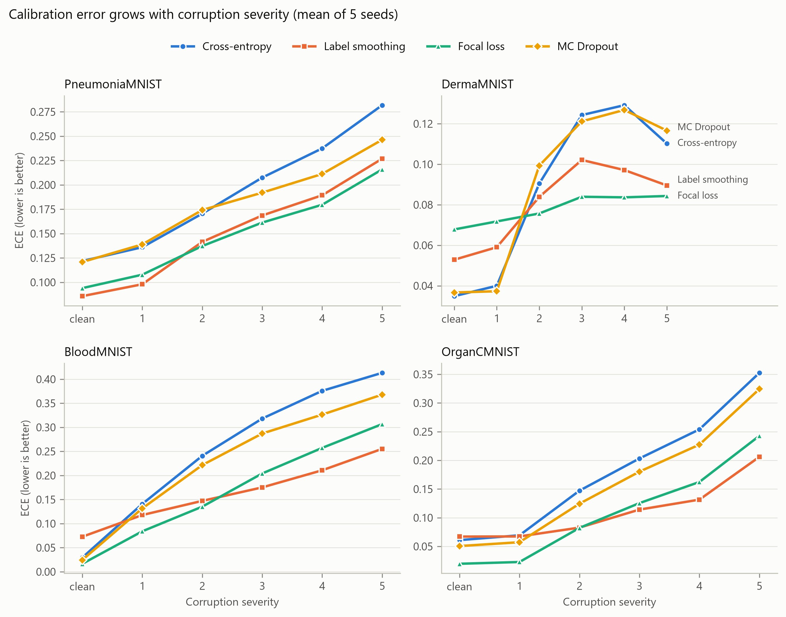
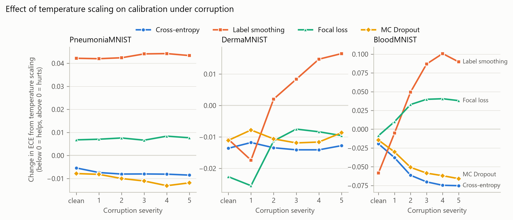
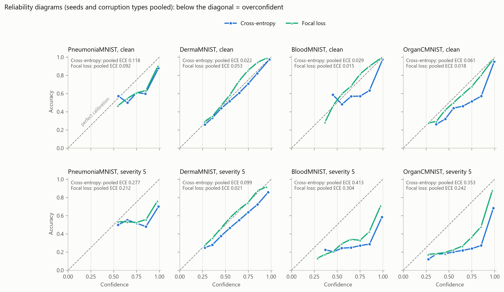

# How Reliable Is Model Confidence Under Distribution Shift?

M.Sc. AI thesis: calibration and uncertainty estimation for medical image classification on [MedMNIST v2](https://medmnist.com/).

## Setup

```bash
python -m venv .venv
.venv/Scripts/python -m pip install -r requirements.txt --extra-index-url https://download.pytorch.org/whl/cu126
```

Tested on a GTX 1050 Ti (4 GB): ResNet-18 at 28px uses ~700 MiB, ~10 s/epoch on PneumoniaMNIST.

## Usage

```bash
# all methods (cross-entropy, label smoothing, focal loss, MC Dropout) x seeds 0-4; resumable
python run_all.py --data pneumoniamnist --epochs 50

# summary tables: clean test set, plus ECE / accuracy under 5 corruptions x 5 severities
python analyze.py --data pneumoniamnist
```

| File | Purpose |
|---|---|
| `train_baseline.py` | One training run: ResNet-18, `--loss ce/ls/focal`, `--dropout`, `--select auc/nll`; saves logits for val, test, MC Dropout and 25 corrupted test sets |
| `corrupt.py` | Test-time corruptions (noise, blur, contrast, brightness, JPEG) at 5 severities, after CIFAR-10-C |
| `temp_scale.py` | Temperature scaling on saved logits |
| `run_all.py` | Runs every method x seed; skips finished runs |
| `analyze.py` | Mean ± std over seeds, temperature scaling, ensembles, shift tables |
| `significance.py` | Paired Wilcoxon tests (Holm-corrected), pooled over datasets and seeds |
| `rq_summary.py` | RQ3 (calibration vs selective prediction) and RQ4 (cheap methods vs ensembles) across datasets |
| `ood.py` | Out-of-distribution detection with the saved models (inference only, cached) |
| `figures.py` | Thesis figures (ECE vs severity, temperature-scaling effect, reliability diagrams) |

## Key findings

4 datasets x 4 methods x 5 seeds; significance = paired Wilcoxon over 20 (dataset, seed) pairs, Holm-corrected.

1. **Calibration degrades under shift for every method** (RQ1). Cross-entropy ECE grows up to 14x
   from clean to severity-5 corruption (BloodMNIST: 0.029 → 0.413).
2. **Calibration built into training is more robust to shift.** At severity 5, label smoothing
   (−0.105 ECE, 18/20 pairs, p = 0.0001) and focal loss (−0.089, 19/20, p = 0.0001) beat cross-entropy;
   MC Dropout helps less (−0.027, 14/20, p = 0.03); 5-seed ensembles are the most robust overall.
3. **Temperature scaling cannot remove a validation/test label shift** (RQ2). It significantly improves
   cross-entropy (clean: 18/20, p = 0.0005). Where val and test class balance match (DermaMNIST,
   BloodMNIST) the remaining test − val ECE gap is ≈ 0; where they differ it stays: PneumoniaMNIST
   (class-distribution distance 0.117) +0.104 → +0.104, OrganCMNIST (0.191) +0.047 → +0.025.
4. **Temperature scaling can make a robust method fragile.** Label smoothing and focal loss leave models
   slightly underconfident (T < 1); temperature scaling removes that margin, and label smoothing + TS is
   worse under corruption in 20/20 pairs (+0.067 ECE at severity 5, p < 0.0001).
5. **No method is reliably best on clean data**: label smoothing and focal loss vs cross-entropy are not
   significant on clean data; the ranking flips between datasets.
6. **Trade-off:** label smoothing lowers AUC in 18/20 pairs (p = 0.001); the effect is large on
   PneumoniaMNIST (−0.1) and small elsewhere (≤ 0.01).
7. **Calibration ≠ selective prediction (RQ3).** How well confidence ranks right above wrong answers
   (E-AURC) is weakly and inconsistently related to ECE (Spearman ρ −0.23 to +0.40 across datasets).
   Temperature scaling changes ECE a lot but E-AURC by < 0.001; label smoothing is better calibrated
   under shift yet significantly worse at selective prediction (clean: 19/20 pairs, p = 0.0001).
8. **Cheap methods vs ensembles (RQ4).** At 1/5 of the cost, single label-smoothing and focal-loss models
   match the cross-entropy ensemble's calibration under shift (ECE sev 5: 0.194 and 0.212 vs 0.216, not
   significantly different); plain cross-entropy, CE + temperature scaling and MC Dropout are significantly
   worse. For selective prediction, ensembles add little. Details: [rq3_rq4_summary.md](rq3_rq4_summary.md).
9. **Confidence does not flag foreign images (OOD).** Max-softmax AUROC for telling a model's own test
   images from other modalities ranges from 0.90 (OrganCMNIST) to **0.30** (BloodMNIST: more confident on
   X-rays than on blood cells), and no method changes this significantly; ensembles help slightly on all
   four datasets. Details: [results_ood.md](results_ood.md).
10. **Methodology:** selecting checkpoints by val AUC is close to arbitrary (val AUC is flat for most of
   training), so checkpoints are selected by val NLL, which cut seed-to-seed ECE spread about 3x.





Limitations: 28px images; OOD uses only the max-softmax score and other MedMNIST modalities (far-OOD); MC Dropout uses dropout before the classifier only (it adds little over a
single pass); on imbalanced DermaMNIST, heavy corruption pushes predictions to the majority class, so
shift results are also reported as balanced accuracy.

## Results

Main experiments (4 methods x 5 seeds, checkpoint selected by val NLL, 50 epochs, clean + 25 corrupted test sets):
[PneumoniaMNIST](results_pneumoniamnist_nll.md) · [DermaMNIST](results_dermamnist_nll.md) · [BloodMNIST](results_bloodmnist_nll.md) ·
[OrganCMNIST](results_organcmnist_nll.md) · [pooled significance tests](significance_pneumoniamnist_dermamnist_bloodmnist_organcmnist_nll.md)
(`python significance.py --data pneumoniamnist dermamnist bloodmnist organcmnist`).

Earlier: [results_pneumoniamnist_auc.md](results_pneumoniamnist_auc.md): 5 seeds, checkpoint selected by val AUC (MedMNIST protocol), clean test only.

### Seed 0 only (PneumoniaMNIST, 28px)

| | Acc | AUC | ECE | NLL |
|---|---|---|---|---|
| MedMNIST v2 paper (ResNet-18) | 0.854 | 0.944 | – | – |
| Baseline, best val-AUC checkpoint (epoch 5) | 0.894 | 0.950 | 0.075 | 0.437 |
| + Temperature scaling (T = 1.93) | 0.894 | 0.950 | 0.039 | 0.286 |
| Label smoothing 0.1 (epoch 3) | 0.873 | 0.889 | 0.040 | 0.357 |
| + Temperature scaling (T = 0.59) | 0.873 | 0.889 | 0.085 | 0.462 |
| Focal loss γ=3 (epoch 4) | 0.861 | 0.954 | 0.051 | 0.351 |
| + Temperature scaling (T = 0.47) | 0.861 | 0.954 | 0.098 | 0.521 |
| Baseline, last epoch (100) | 0.843 | 0.937 | 0.146 | 1.387 |
| + Temperature scaling (T = 3.15) | 0.843 | 0.939 | 0.113 | 0.488 |

Note: PneumoniaMNIST has a built-in label shift — pneumonia is 74.2% of val but 62.5% of test —
so temperatures fitted on val do not transfer cleanly to test.
